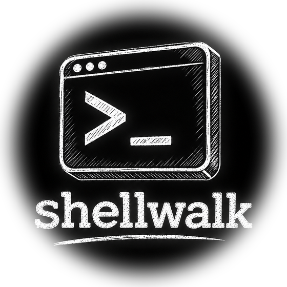
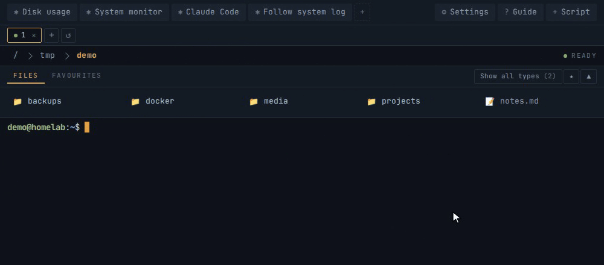
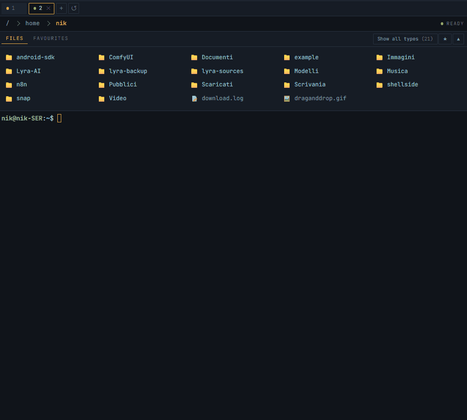
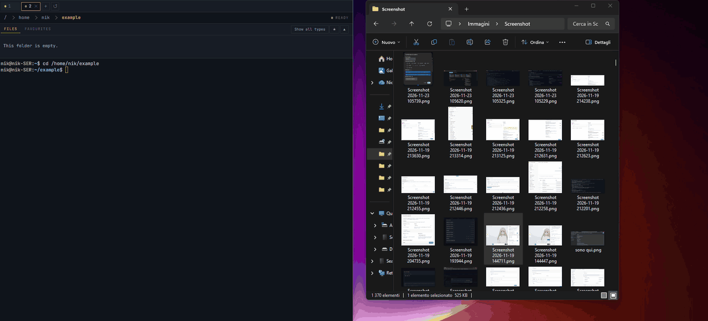
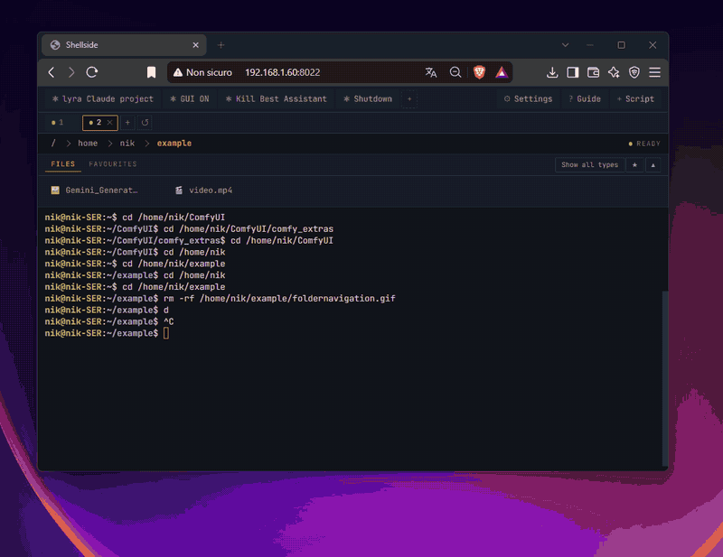
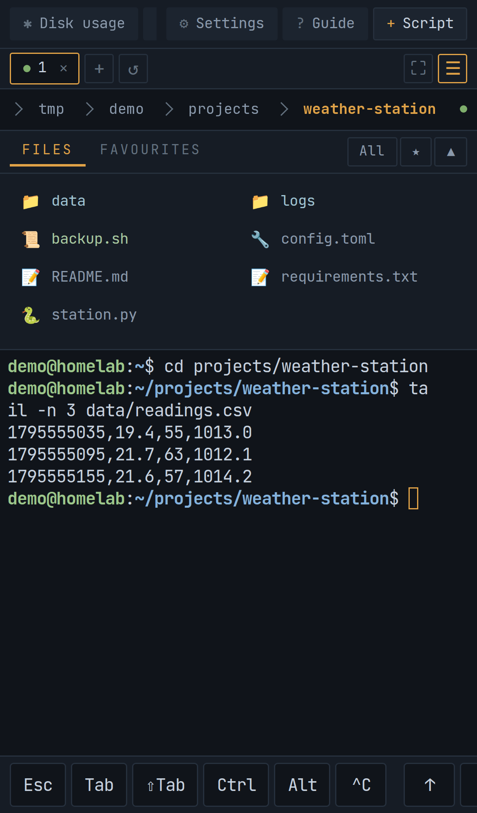

<p align="center"></p>

# Shellside

**Use your headless Linux machine from any browser: a real terminal, with a file
manager that follows it.**

Shellside runs on the Linux machine that has no screen — a home server, a
Raspberry Pi, the PC in the corner — and you open it from a browser on any other
device: a Windows or Mac laptop, a tablet, your phone. You get a real shell on
that machine (vim, htop, `tail -f`, ssh all work), and right above it, the files
of the folder you are in.



## What you can do with it

- **Move around without typing `cd` and `ls`.** The bar at the top shows where
  you are and the files around you. Click a folder and Shellside runs the `cd`
  in your terminal for you; click a part of the path to go back. It works the
  other way too: type `cd` in the terminal and the panel follows by itself.
  Star the folders you use most and find them under **Favourites**.

  

- **Move files with drag and drop.** Drag a file from the panel onto your
  desktop to download it. Drop files from your computer onto the panel or the
  terminal to upload them into the folder you are in. No `scp`, no second program.

  

  *Two different machines: on the left, Shellside in a browser on a Windows PC,
  showing a folder on the Linux server; on the right, a folder on the Windows PC
  itself. Files go both ways with a drag.*

- **See photos, videos and music on a machine with no screen.** Click an image,
  a video, an audio file or a PDF and it opens in a new browser tab.

  

- **Use it from your phone.** Sit on the sofa and work on the server. The phone
  gets an extra row of the keys its keyboard lacks (Esc, Tab, Ctrl, Alt, arrows),
  and long-press replaces right-click. There is no mouse and no drag and drop on
  a phone, but everything else is there.
- **Your terminals live on the server, not in the browser.** Start something on
  your PC, carry on from your phone, go back to the PC: the same tabs, the same
  shells, the same output. A dropped connection comes back to the same shell.
- **Run Claude Code from anywhere.** Start `claude` on the server (there is a
  button for it in the top bar) and follow it, or answer it, from your phone or
  any computer. The same goes for any long-running terminal program.
- **Click a file to act on it.** Right-click a file for edit, rename, move,
  download, remove and more; text files open in an editor in the browser. You
  choose what a click does for each file type in **Settings › File types**: for
  example, a click on a `.py` file types `python3 <that file>` in the terminal.
- **Keep your frequent commands one click away**, as buttons in the top bar.
- **Get help when a command goes wrong.** Connect a model in **Settings ›
  Model** (a local one through Ollama, or any OpenAI-compatible API). When you
  type a command that doesn't exist, or a question that starts with a comma, its
  suggestions appear in the terminal.
- **Safe by default.** Out of the box it answers only on the machine itself.
  Setup can open it to your local network, and only behind a password. Read the
  next section before you install it.

---

## Read this before you install it

**Shellside hands out a shell on the host it runs on. Anyone who reaches it and
gets past the login has whatever your user has.** That is the entire point of the
tool, and it is also its threat model. Treat it like `sshd`, not like a web app.

What it does about that:

- **Binds `127.0.0.1` by default.** The LAN address answers only after you choose
  it in `./shellside setup`, and only while a password protects it: with no LAN
  password (and no live setup password) it falls back to loopback at startup.
- **One unconditional gate**, `server/gate.py`, in front of every HTTP route and
  every websocket, checked before the PTY or a directory listing is ever touched.
  It cannot be turned off by configuration.
- **Loopback is trusted only when it really is this machine.** Only while the
  bind is loopback, never for a request a tunnel or proxy relayed (it carries
  proxy headers), never for a foreign `Host` (DNS rebinding). With a tunnel,
  answer yes to the tunnel question in setup and loopback is not trusted at all.
- **A LAN password**, scrypt-hashed, chosen on the first sign-in with the
  one-time setup password. Per-address throttling and lockout are configurable.
- **An internet password** for enrolling devices through a tunnel: limited uses,
  an expiry, and a revocable credential per device.
- **A recovery link**, new at every boot, valid from this machine only
  (`./shellside link` prints it; it never goes into the logs), so
  physical access to the machine always gets you back in.
- Previewed `.html` and `.svg` are served with `Content-Security-Policy: sandbox`,
  or a previewed file could run script on the origin that owns your shell.

What it does **not** do, and what you should assume:

- **No audit log** of executed commands. Do not use it where you would need one.
- **No TLS of its own.** The intended deployment is a Cloudflare tunnel (or any
  reverse proxy you trust) in front of loopback. Over plain LAN HTTP the password
  and session cookie cross the wire in clear.
- **No sandbox, no privilege separation.** The shell runs as the user that
  started Shellside. Do not run it as root.
- **Not audited**, by me or anyone else. It is a home-lab appliance written for
  its author's machine, published because it may be useful. Exposing it directly
  to the internet is your risk to take, and I would not.
- If a **model backend** is configured, the text you send to Ask-the-model — and
  the context it attaches — goes wherever that backend points. `ollama` keeps it
  on your machine; `openai_compatible` does not.

---

## Quick start

```bash
git clone https://github.com/niccolostefani93-spec/shellside
cd shellside
bash setup.sh
```

`setup.sh` builds the virtualenv (upgrading pip *inside it* first, then checking
that every dependency really imports) and starts a short guided setup (three questions, plus one about tunnels):

1. **Who can open it:** only this machine, or every device on your local network.
2. **Port:** 8022 unless you pick another.
3. **Start at boot:** installs a systemd *user* service, no sudo needed.

If you chose the local network, it prints the address to open from your phone or
laptop and a **one-time setup password**. Sign in with it once (within 30
minutes) and you are asked to choose your real password; the setup password then
stops working. Nothing is ever exposed to the network without a password: if
none is set, Shellside listens on `127.0.0.1` whatever the settings say.

Open the address it prints: a short guided tour shows the interface the first
time (**Guide** in the top bar brings it back).

Afterwards:

```bash
./shellside                # start it by hand (if you skipped autostart)
./shellside status         # what is configured, and whether it runs
./shellside setup          # change the answers
./shellside reset-auth     # forgot the password: back to the unconfigured state
./shellside link           # sign-in link for a browser on this machine
```

These run in a shell on the machine itself (at the keyboard, over SSH, or in a
Shellside terminal you are already signed in to). Nothing on the web side can
trigger them: being able to run them already means having that user's access.

The fourth setup question asks whether you will reach Shellside from the
internet through a tunnel or reverse proxy. Such a tunnel connects from
`127.0.0.1`, so answering yes switches on *tunnel mode*: requests from
`127.0.0.1` are no longer trusted by themselves, and a browser on the machine
signs in once with the link from `./shellside link`.

Pass an interpreter to pick one: `bash setup.sh python3.13`. To reach it from
outside your network, put a tunnel in front of loopback rather than opening the
port (see *Deploying behind Cloudflare* in the full documentation).

**Requirements:** Linux, Python 3.11+. The working-directory detection reads
`/proc`, so macOS and BSD need a different implementation of one method
(`PtySession.cwd()`); everything else is portable.

---

## What actually makes it different

Plenty of projects put a terminal in a browser. The interesting part here is what
sits next to it.

**The panel reads the kernel, not your keystrokes.** Shellside asks
`os.tcgetpgrp()` for the PTY's foreground process group and reads
`/proc/<pgid>/cwd`. That is the kernel's own answer, so it is right in the cases
that defeat parsing what you typed:

| Input | Parsing stdin | Reading `/proc` |
|---|---|---|
| `cd /tmp` | correct | correct |
| `cd -` | wrong | correct |
| `pushd /var/log` | wrong | correct |
| `T=/etc; cd $T` | wrong | correct |
| `goto(){ cd /usr/share; }; goto` | wrong | correct |

The panel never runs `ls`, either — the backend uses `os.scandir`, so browsing
costs one syscall and leaves nothing in your scrollback.

**Navigation runs. Almost everything else types and waits.** Clicking a
breadcrumb runs the `cd`, because the panel has to follow the shell. Most other
actions are written to the prompt and left there for you to read and press
Enter. The exception is **Remove**: it asks for confirmation in a dialog, then
runs. Each action has its own switches (`execute`, `confirm` in its manifest) if
you disagree.

**Substituted values are shell-quoted.** For a file named `a b; rm -rf ~`:

```
unquoted →  rm -rf /tmp/a b; rm -rf ~      ← deletes your home directory
quoted   →  rm -rf '/tmp/a b; rm -rf ~'    ← what you meant
```

**Injection refuses to type into a running program.** If vim owns the terminal,
`rm -rf {file_path}` would be typed *into vim*. Shellside checks that the shell
itself holds the foreground group first.

**Sessions outlive their websocket.** A phone that drops its connection
reconnects to the same shell and gets its scrollback replayed.

<p align="center"></p>

**Tabs are real, separate shells, not a visual trick.** Each one is its own PTY
with its own working directory. The folder panel always shows whichever tab is
active, and switching tabs asks that tab's own connection to confirm its listing
— so if you ran something in tab 2 that changed a file, tab 2's view is already
right by the time you look at it, not stale until you happen to touch it.
Backgrounded tabs keep running: a `tail -f` in tab 3 keeps landing in tab 3's
scrollback while you work in tab 1.

---

## Everything is a folder

There is no plugin registry. A context-menu action is a folder with a
`manifest.json`, and that is the whole extension mechanism:

```
app/context_menu/file_entry/checksum/
  manifest.json   {"name": "Checksum", "icon": "#", "order": 55,
                   "match": {"extensions": [".iso", ".img"]}}
  command.txt     sha256sum {file_path}
```

Drop it in and it appears — the discovery pass watches mtimes. Placeholders:
`{file_name}` `{file_path}` `{file_dir}` `{cwd}` `{target_path}` `{selection}`
`{home}`, all quoted unless the manifest opts out.

The same shape drives the top bar, the settings tabs and the saved commands. When
one templated command isn't enough, add `routes.py` with an `invoke(ctx)`.
Context menus and saved commands can also be edited from the interface, and
changes to the ones that ship with the project are kept in a separate overrides
file so an update cannot silently revert them.

Cross-cutting integrations are folders too, under `services/`:

| Category | Interface | Ships with |
|---|---|---|
| `llm` | `ask(prompt, context) -> str` | `ollama`, `openai_compatible`, `echo` |

Core code never imports a connector.

---

## Updating

```bash
git pull
systemctl --user restart shellside     # or stop and start ./shellside
```

Your settings, passwords and saved commands live in `~/.config/shellside`, not in
the code folder, so a pull never touches them.

For a headless machine administered from a phone there is also
**Settings › Update / Backup**: import a zip of new code, preview what it will
touch, then apply. The merge does not happen inside the running app — `run.py`
is a supervisor, the app is its child, and the files are replaced while the app
is down. Incoming Python is compiled at preview time, and the preview names any
shell still running a job before you commit, because a restart ends every open
shell (unless you keep shells in tmux, Settings › General).

---

## Comparison

| | Shellside | ttyd / Wetty / gotty | code-server | filebrowser |
|---|---|---|---|---|
| Real PTY | yes | yes | yes | no |
| File panel tracking the shell's cwd | yes | no | no | n/a |
| Click-to-command menus | yes | no | partial | no |
| Weight | one Python process | one process | heavy | light |

If you want a terminal in a tab, ttyd is smaller and older and you should use it.
Shellside is for when you keep wanting the file manager and the shell to be the
same thing.

---

## Known gaps

- Linux only, for the `/proc` reason above.
- No audit log of executed commands.
- `Move`'s picker lists directories only.
- No TLS of its own: on a plain LAN the password crosses the network in clear.
- The mtime discovery scan is O(files under `app/`) — fine at this size, swap in
  `watchfiles` if that tree grows.
- Settings cover the common fields; the rest of `settings.json` is
  hand-edited.

Full documentation, including the access-control design, tunnels, the update
format and how to add your own actions, is in [docs/HANDBOOK.md](docs/HANDBOOK.md).

## Roadmap

What comes next, roughly in this order. Ideas and help are welcome: open an
issue to discuss any of them before you start.

1. **Guided remote access.** Reaching your machine from outside your home
   network is the hardest part today: you set up the tunnel yourself. Setup will
   walk you through Tailscale or a Cloudflare tunnel, step by step.
2. **HTTPS on the local network.** Over plain LAN HTTP the password and the
   session cookie cross the network in clear. Shellside will serve HTTPS on its
   own, so the LAN is as safe as the tunnel.
3. **Recipes.** Ready-made packs of commands and click actions (Docker, git,
   Claude Code, media servers…) that you copy into `app/`. A good first
   contribution: a recipe needs no change to Shellside itself.
4. **Notifications.** A message on your phone (through ntfy or a webhook) when a
   long command finishes, or when Claude Code is waiting for you.

## License

MIT. See [LICENSE](LICENSE).

## Contributing

Issues and PRs welcome; see [CONTRIBUTING.md](CONTRIBUTING.md). If you are
reporting something security-relevant, please follow [SECURITY.md](SECURITY.md)
rather than opening a public issue.

## How it was made

Shellside was written with substantial help from AI coding assistants (Claude).
Every change was reviewed, run and tested by the maintainer, and the security
design is described in full in the handbook so you can judge it yourself.
