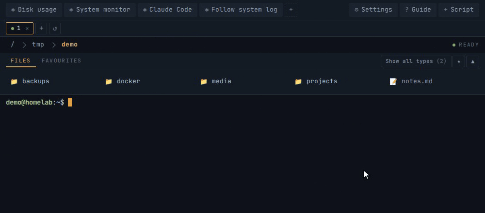

# Shellside

**A real Linux shell in your browser, with a file manager that follows it.**

The terminal is a genuine PTY — vim, htop, `tail -f`, background jobs and ssh all
work. Beside it sits a folder panel that tracks the shell's working directory by
itself: `cd`, `pushd`, `cd -`, a shell function that changes directory, and the
panel is already there. Click a file and you get a menu of actions that type real
commands into that same shell.

**The files on the server are not just visible — they're reachable.** Browse into
any folder the shell can reach, open what the browser can render, download
anything to your device, or upload straight into whatever folder the shell is
currently sitting in. No separate file-transfer step, no `scp` from another
terminal: it's the same panel that's already open next to the shell.

Built for the machine in the corner that has no monitor, and for administering it
from a phone.

<!-- Record a 10-second GIF and put it here. Suggested take:
     cd into a folder from the terminal, watch the panel follow; right-click a
     file, pick Remove, press Enter, watch it disappear from the panel.
     This one image will do more work than the rest of this file. -->


---

## Read this before you install it

**Shellside hands out a shell on the host it runs on. Anyone who reaches it and
gets past the login has whatever your user has.** That is the entire point of the
tool, and it is also its threat model. Treat it like `sshd`, not like a web app.

What it does about that:

- **Binds `127.0.0.1` by default.** The LAN address does not answer until you
  explicitly pass `--host 0.0.0.0`, and doing so prints a warning.
- **One unconditional gate**, `server/gate.py`, in front of every HTTP route and
  every websocket, checked before the PTY or a directory listing is ever touched.
  It cannot be turned off by configuration.
- **Loopback is trusted only while the bind is loopback.** Bind wider and that
  rule stops applying, so a local process can't inherit it. The check uses the
  real TCP peer — a forged `X-Forwarded-For: 127.0.0.1` is rejected.
- **A LAN password**, scrypt-hashed, set from the machine itself. Binding wide
  with no password set denies everyone except the local machine rather than
  quietly staying open. Per-address throttling and lockout are configurable.
- **A recovery link** printed at every boot, valid from loopback only, so
  physical access to the machine always gets you back in.
- Previewed `.html` and `.svg` are served with `Content-Security-Policy: sandbox`,
  or a previewed file could run script on the origin that owns your shell.

What it does **not** do, and what you should assume:

- **No audit log** of executed commands. Do not use it where you would need one.
- **No TLS of its own.** The intended deployment is a Cloudflare tunnel (or any
  reverse proxy you trust) in front of loopback. Over plain LAN HTTP the password
  and session cookie cross the wire in clear.
- **No sandbox, no privilege separation.** The shell runs as the user that
  started Shellside. Do not run it as root.
- **Not audited**, by me or anyone else. It is a home-lab appliance written for
  its author's machine, published because it may be useful. Exposing it directly
  to the internet is your risk to take, and I would not.
- If a **model backend** is configured, the text you send to Ask-the-model — and
  the context it attaches — goes wherever that backend points. `ollama` keeps it
  on your machine; `openai_compatible` does not.

---

## Quick start

```bash
git clone https://github.com/<you>/shellside
cd shellside
bash setup.sh
.venv/bin/python run.py          # http://127.0.0.1:8022
```

`setup.sh` builds the virtualenv, upgrades pip *inside it* before installing
anything, then verifies each dependency actually imports. Pass an interpreter to
pick one: `bash setup.sh python3.13`.

To reach it from another device, put a tunnel in front of loopback rather than
opening the port:

```bash
cloudflared tunnel --url http://127.0.0.1:8022
```

If you would rather have a LAN route, set a password in **Settings › Access**
first, then `run.py --host 0.0.0.0`.

**Requirements:** Linux, Python 3.11+. The working-directory detection reads
`/proc`, so macOS and BSD need a different implementation of one method
(`PtySession.cwd()`); everything else is portable.

---

## What actually makes it different

Plenty of projects put a terminal in a browser. The interesting part here is what
sits next to it.

**The panel reads the kernel, not your keystrokes.** Shellside asks
`os.tcgetpgrp()` for the PTY's foreground process group and reads
`/proc/<pgid>/cwd`. That is the kernel's own answer, so it is right in the cases
that defeat parsing what you typed:

| Input | Parsing stdin | Reading `/proc` |
|---|---|---|
| `cd /tmp` | correct | correct |
| `cd -` | wrong | correct |
| `pushd /var/log` | wrong | correct |
| `T=/etc; cd $T` | wrong | correct |
| `goto(){ cd /usr/share; }; goto` | wrong | correct |

The panel never runs `ls`, either — the backend uses `os.scandir`, so browsing
costs one syscall and leaves nothing in your scrollback.

**Navigation runs. Everything else types and waits.** Clicking a breadcrumb runs
the `cd`, because the panel has to follow the shell. Every other action —
including `rm -rf` — is written to the prompt and left there for you to read and
press Enter. It is a switch per action if you disagree.

**Substituted values are shell-quoted.** For a file named `a b; rm -rf ~`:

```
unquoted →  rm -rf /tmp/a b; rm -rf ~      ← deletes your home directory
quoted   →  rm -rf '/tmp/a b; rm -rf ~'    ← what you meant
```

**Injection refuses to type into a running program.** If vim owns the terminal,
`rm -rf {file_path}` would be typed *into vim*. Shellside checks that the shell
itself holds the foreground group first.

**Sessions outlive their websocket.** A phone that drops its connection
reconnects to the same shell and gets its scrollback replayed.

**Tabs are real, separate shells, not a visual trick.** Each one is its own PTY
with its own working directory. The folder panel always shows whichever tab is
active, and switching tabs asks that tab's own connection to confirm its listing
— so if you ran something in tab 2 that changed a file, tab 2's view is already
right by the time you look at it, not stale until you happen to touch it.
Backgrounded tabs keep running: a `tail -f` in tab 3 keeps landing in tab 3's
scrollback while you work in tab 1.

---

## Everything is a folder

There is no plugin registry. A context-menu action is a folder with a
`manifest.json`, and that is the whole extension mechanism:

```
app/context_menu/file_entry/checksum/
  manifest.json   {"name": "Checksum", "icon": "#", "order": 55,
                   "match": {"extensions": [".iso", ".img"]}}
  command.txt     sha256sum {file_path}
```

Drop it in and it appears — the discovery pass watches mtimes. Placeholders:
`{file_name}` `{file_path}` `{file_dir}` `{cwd}` `{target_path}` `{selection}`
`{home}`, all quoted unless the manifest opts out.

The same shape drives the top bar, the settings tabs and the saved commands. When
one templated command isn't enough, add `routes.py` with an `invoke(ctx)`.
Context menus and saved commands can also be edited from the interface, and
changes to the ones that ship with the project are kept in a separate overrides
file so an update cannot silently revert them.

Cross-cutting integrations are folders too, under `services/`:

| Category | Interface | Ships with |
|---|---|---|
| `llm` | `ask(prompt, context) -> str` | `ollama`, `openai_compatible`, `echo` |
| `display` | `ensure()`, `launch()`, `status()`, `stop()` | `x11vnc`, `none` |

Core code never imports a connector.

---

## Graphical programs on a headless host

There is no monitor, so Shellside runs a virtual one: Xvfb plus x11vnc, started
on demand, with the VNC socket piped through the app's own port. One origin, one
tunnel hostname, and the access policy you already have covers the desktop too.
`mpv` on a `.mkv`, `gimp` on a `.psd` — launched from your own shell with
`DISPLAY` set, so it inherits your environment and dies on Ctrl-C like anything
else.

```bash
sudo apt install xvfb x11vnc openbox
```

VNC ships pixels, so a static window is nearly free and full-screen video is not.
Switch to the `none` backend and nothing graphical runs on the host at all.

---

## Updating

Updates are imported as a zip from **Settings › Update / Backup**: preview what
it will touch, then apply. The merge does not happen inside the running app —
`run.py` is a supervisor, the app is its child, and the files are replaced while
the app is down. Incoming Python is compiled at preview time, the supervisor
keeps a `.bak` of itself, and the preview names any live PTY mid-job before you
commit, because a restart kills every open shell.

That is deliberately not `git pull`: the target machine is headless, the person
doing the update is often on a phone, and the safety checks that matter here —
*will this kill the rsync I started an hour ago* — are not things git knows about.
Cloning and pulling still works fine if you are sitting at the machine.

---

## Comparison

| | Shellside | ttyd / Wetty / gotty | code-server | filebrowser |
|---|---|---|---|---|
| Real PTY | yes | yes | yes | no |
| File panel tracking the shell's cwd | yes | no | no | n/a |
| Click-to-command menus | yes | no | partial | no |
| Graphical apps | yes (VNC) | no | no | no |
| Weight | one Python process | one process | heavy | light |

If you want a terminal in a tab, ttyd is smaller and older and you should use it.
Shellside is for when you keep wanting the file manager and the shell to be the
same thing.

---

## Known gaps

- Linux only, for the `/proc` reason above.
- No audit log of executed commands.
- `Move`'s picker lists directories only.
- The display inherits the app's authentication and has none of its own.
- The mtime discovery scan is O(files under `app/`) — fine at this size, swap in
  `watchfiles` if that tree grows.
- Settings cover the common fields; the rest of `app/settings.json` is
  hand-edited.

Full documentation, including the access-control design and the update format,
is in [docs/HANDBOOK.md](docs/HANDBOOK.md).

## License

MIT. See [LICENSE](LICENSE).

## Contributing

Issues and PRs welcome. If you are reporting something security-relevant, please
open a private advisory rather than a public issue.
